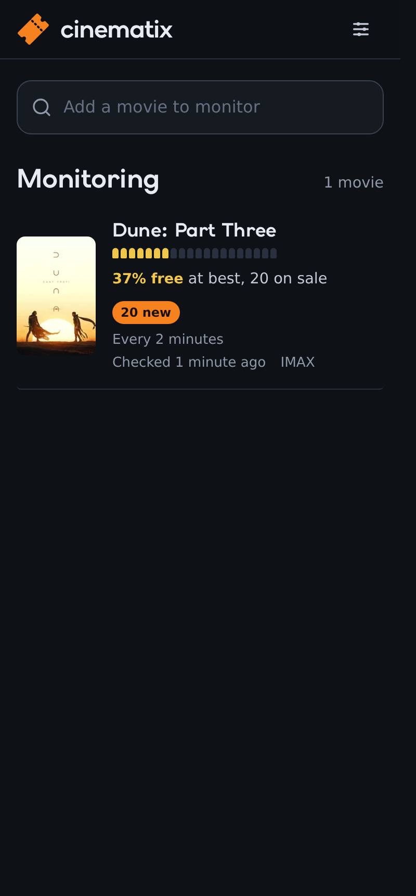
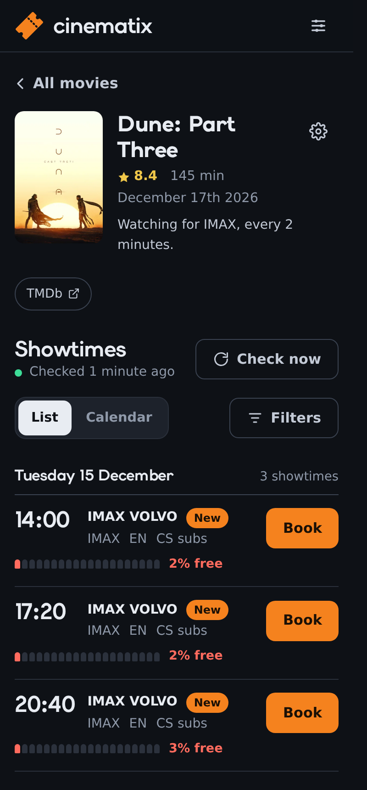
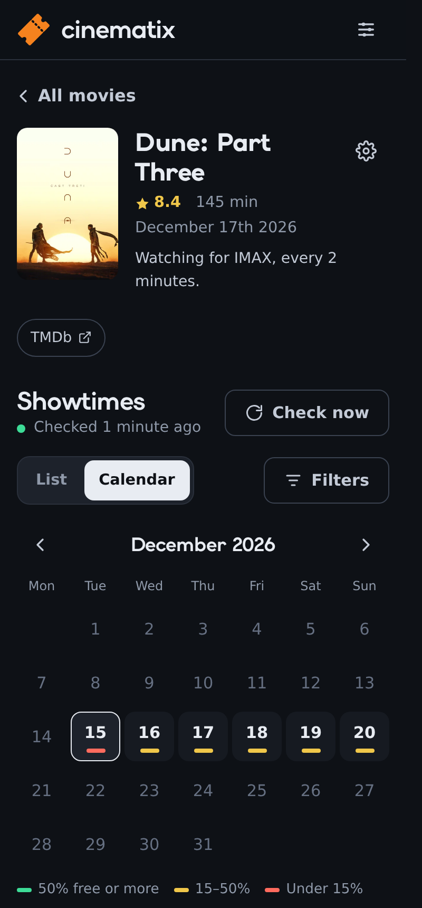

# cinematix

cinematix watches a Cinema City cinema in the Czech Republic for the movies you choose. It sends a push notification to your phone when:

- a new showtime is listed, with the time booking opens if it hasn't opened yet,
- seats free up in a showtime, for example after a sold-out drop when unpaid baskets expire.

It was built for IMAX tickets at Prague Flora, the only IMAX hall in Czechia, where big releases sell out within minutes. It works with every Cinema City cinema in Czechia.

cinematix only watches and notifies. It never selects seats or buys tickets.

<p>
  
  
  
</p>

## Quick start

You need a computer that is always on and has [Docker](https://docs.docker.com/engine/install/) installed, for example a home server, a NAS or a Raspberry Pi (64-bit).

The image is private, so Docker must log in to GitHub once before the first download.

1. Create a [GitHub personal access token (classic)](https://github.com/settings/tokens/new?scopes=read:packages&description=cinematix) with only the `read:packages` scope.
2. Log in on the server once:
   ```sh
   echo <token> | docker login ghcr.io -u <github-user> --password-stdin
   ```
   Docker remembers the login, so later updates need no login.
3. Save this as `docker-compose.yml` (it is also in this repository), then run `docker compose up -d`:
   ```yaml
   services:
     cinematix:
       image: ghcr.io/timojaakob/cinematix:1
       container_name: cinematix
       restart: unless-stopped
       ports:
         - "8090:5000"
       volumes:
         - cinematix-data:/data

   volumes:
     cinematix-data:
   ```
4. Open `http://<server>:8090` and complete the setup wizard.

If step 3 fails with `denied` or `unauthorized`, Docker is not logged in. Do step 2 again.

Without Compose, this one command does the same as step 3:

```sh
docker run -d --name cinematix --restart unless-stopped -p 8090:5000 -v cinematix-data:/data ghcr.io/timojaakob/cinematix:1
```

### Update

1. Run `docker compose pull`.
2. Run `docker compose up -d`.

The `:1` tag gets every 1.x release, but not a future 2.0 that could need manual steps.

## First-run setup

The wizard opens on the first visit and has four steps. Everything can be changed later under **Settings** (the icon at the top right).

1. **Cinema.** Choose one of the Cinema City cinemas in Czechia.
2. **TMDb.** cinematix uses [The Movie Database](https://www.themoviedb.org) for movie search and posters. A key is free: create an account, open [Settings → API](https://www.themoviedb.org/settings/api), and copy the "API Key" or the "API Read Access Token". The **Check** button tests the key.
3. **Notifications.** cinematix sends pushes through [ntfy](https://ntfy.sh), a free app for Android and iPhone. The wizard creates a private topic name for you. Install the ntfy app, subscribe to that topic, and tap **Send test**. Anyone who knows the topic name can read it, so keep it private. A self-hosted ntfy server works too.
4. **Password (optional).** Set a password if other people can reach the server. Leave it empty if the server is only on your home network, or if a reverse proxy already asks for a login.

Then search for a movie, choose the formats you want (IMAX, 4DX, Superscreen, VIP, 3D, 2D), and cinematix starts checking.

## Install on your phone

cinematix is a web app that can be added to the home screen, where it opens like an app. Browsers allow this only over HTTPS. Over plain `http://` on your home network it still works in the browser, but it cannot be installed.

Two easy ways to get HTTPS:

- **Tailscale.** Install [Tailscale](https://tailscale.com) on the server and your phone, then run `tailscale serve --bg 8090` on the server. Open the `https://….ts.net` address it prints on your phone. This also lets you reach cinematix away from home, without opening ports.
- **A reverse proxy with TLS**, for example Caddy, Traefik or Nginx Proxy Manager, in front of port 8090.

Then:

- **Android (Chrome):** open the menu and tap **Add to Home screen**.
- **iPhone (Safari):** tap **Share**, then **Add to Home Screen**.

Afterwards, enter the HTTPS address under **Settings → Address of this app**. A notification about several showtimes opens this address.

## Advanced settings

Everything you choose is set in the web UI and stored in `/data/config.json`. These env vars are optional:

| Variable | Default | Description |
|---|---|---|
| `PUID`, `PGID` | `1000` | User and group the app runs as. Set them to your user's IDs if `/data` is a bind mount, so the files belong to you. |
| `AVAILABILITY_RISE_THRESHOLD` | `0` | A "seats freed up" push is sent when free seats rise by more than this share of the hall. `0` means any returned seat, `0.01` means 1 %. |
| `OUTAGE_ALERT_AFTER_SECONDS` | `300` | How long Cinema City can be unreachable before you get an alert. |
| `DEBUG` | `false` | Verbose logs, including raw API responses. |

Check intervals are per movie, between every minute and once a day. Please keep them reasonable: every request goes to Cinema City's servers.

Logs: `docker compose logs -f cinematix`.

## How it works

Cinema City has no public API. cinematix uses the internal JSON endpoints behind its website (the feed builds on [ra100/cinema-loader](https://github.com/ra100/cinema-loader)). They are unofficial and can change without notice.

| Endpoint | Used for |
|---|---|
| `GET www.cinemacity.cz/cz/data-api-service/v1/quickbook/10101/cinemas/with-event/until/{date}` | The cinema list in the setup wizard and settings |
| `GET …/quickbook/10101/dates/in-cinema/{cinemaId}/until/{date}` | Dates that have screenings |
| `GET …/quickbook/10101/film-events/in-cinema/{cinemaId}/at-date/{date}` | One day's films (`body.films[]`) and showtimes (`body.events[]`, joined on `filmId`) |
| `GET tickets.cinemacity.cz/api/presentations/{eventId}` | When booking opens and closes |

Findings built into the code:

- **Sold out.** The `soldOut` flag alone is unreliable (seen `false` at under 1 % free), so `availabilityRatio <= 0` also counts as sold out.
- **Free seats.** `availabilityRatio` has 4 decimals, fine enough to show a single returned seat even in the IMAX hall.
- **Formats.** IMAX is Flora's `auditoriumTinyName == "IMAX"` hall or the `70-mm`/`imax` tags. The other hall types are the `4dx`, `superscreen` and `vip` tags, then `3d`. Everything else is 2D. `dolby-atmos` is sound, not a hall, and is ignored.
- **Booking links.** The feed's `bookingLink` points at `tickets.cinemacity.cz/api/order/{id}`, which returns 404. The working link drops `/api/`.
- **Unpublished dates** return HTTP 200 with empty arrays, not an error.
- **Booking open time.** Showtimes are often listed days before booking opens, and the feed doesn't say when. The booking site's presentation endpoint does. While a showtime is locked it returns `{"error": {"error": "TICKETING_NOT_STARTED", "data": "2026-10-20 09:00"}}`. Once open, it returns `presentation.ticketSaleStart`. It answers HTTP 200 even for errors and needs no login or reCAPTCHA. cinematix fetches it once per matched showtime and rechecks upcoming times hourly until booking opens.
- **Time zone.** All times from the APIs are Prague local time without an offset. cinematix compares them with Prague time itself, so the container's time zone doesn't matter.

Files in `/data`:

| File | Content | Written by |
|---|---|---|
| `config.json` | Movies and settings | Web UI |
| `state.json` | Notification history, seat baselines, booking open times, last check per movie | Scraper |
| `results.json` | Current matching showtimes | Scraper |
| `secret_key` | Signs the login session | Created once |

## Limitations

- The APIs are unofficial. A change on Cinema City's side can break cinematix until it is updated.
- One cinema at a time, Czech Republic only.
- A movie matches by plain text: its match text must appear in Cinema City's listing title. cinematix uses the English listing titles, so the TMDb title usually matches. If it doesn't, edit the match text in the movie's settings.
- A 4DX 3D showing counts as 4DX: hall types win over 3D.
- If Cinema City starts to block requests, cinematix backs off for up to 15 minutes and sends an alert.

## Disclaimer

cinematix is an unofficial hobby project. It is not affiliated with, endorsed by, or connected to Cinema City or Cineworld Group. All trademarks belong to their owners. It reads only public showtime data that the Cinema City website also shows, and it identifies itself to Cinema City with a User-Agent that names this project. Use it at your own risk and keep the check intervals reasonable.

## Development

```sh
python -m venv .venv && . .venv/bin/activate
pip install -r requirements-dev.txt
pytest
DATA_DIR=./data python webui.py      # web UI on http://localhost:5000
DATA_DIR=./data python scraper.py    # in a second terminal
```

The tests use responses captured from the live APIs (`tests/fixtures/`), so they need no network.

To release, set the version in `version.py`, add it to `CHANGELOG.md`, and push a tag like `v1.0.1`. GitHub Actions runs the tests and pushes the image for amd64 and arm64 to `ghcr.io/timojaakob/cinematix`.

## Credits

The showtime feed was first reverse-engineered by [ra100/cinema-loader](https://github.com/ra100/cinema-loader). Movie data and posters come from [TMDb](https://www.themoviedb.org); cinematix uses the TMDb API but is not endorsed or certified by TMDb.

## License

[MIT](LICENSE)
